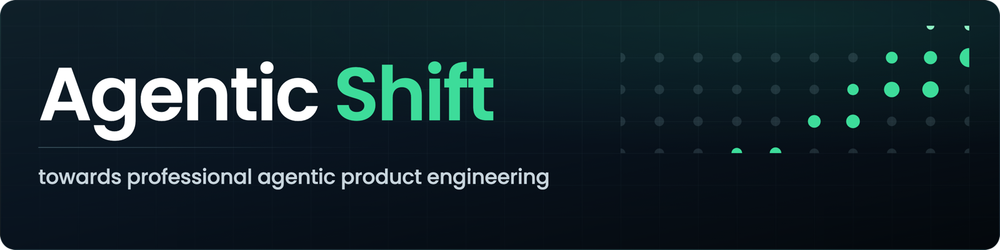

<p align="center">
  
</p>

# Agentic Shift

<!-- MANIFESTO:START -->

> _Generated from [`manifesto/v4/en.json`](manifesto/v4/en.json) — edit the JSON, then run `node manifesto/build.js`. Do not edit this section by hand._

_From tokenmaxing and other AI theater toward healthy organizations where people thrive and build great products and services._

## What we shift toward

We use AI tools every day, and we enjoy them. AI is a democratized technology. Everyone has it, so on its own it gives no one an edge. It accelerates whatever tendencies an organization already has. So it is important to know your competitive advantage and how to amplify it with a strategic AI adoption, instead of sprinkling AI around because of the FOMO the AI vendors spread.

Below are the shifts that organizations wanting sustainable quality, real customer value and high adaptability make.

## Own your shift

- **narrow specialists → complete craftspeople** — Enabling product engineers to shift from narrow, assembly-line specialists to end-to-end craftspeople — with AI filling the specialist gaps and offering upskilling for entering new domains.
- **coordinating dependencies → extreme cocreation** — Instead of coordinating fragments through handoffs and integration meetings, complete craftspeople work in flow with their agents and with each other, alternating between focused work and looking at the whole product together, improving it as a whole.
- **coding features → designing agentic systems** — Moving product engineers from coding features one by one to designing the agentic systems that build them — self-improving loops that turn intent into tested, working software and verify every change against tests and specs, while product engineers own the tests and the value loop.
- **the telephone game → zero distance to users** — Ending the telephone game through manager-proxies and the era of “IT sitting in the basement” — instead putting product engineers at zero distance with the customers and users, to empathize, analyze, and synthesize firsthand.
- **counting output → owning outcomes** — Elevating product engineers from counting output to owning the complete value loop — ensuring real customer impact, experimenting and course-correcting as the evidence comes in.
- **work follows people → people follow value** — Organizing around value instead of around existing roles and team boundaries — product engineers move to where the most valuable work is as priorities shift, which keeps the whole organization adaptable.

## How to use the shifts

These shifts are not a checklist. Not every organization needs all six, and not all to the same depth. Which ones matter, and how far you take each one, depends on your product, your customers and the competitive advantage you want to build.

Use them as inspiration to define your strategy. Pick the shifts that strengthen your advantage, decide how far to go with each, and only then choose where AI amplifies them. Revisit the mix as you learn. That is how you own the agentic shift and make it happen on your terms.

## What's Next?

**Want to contribute?** [Propose improvements](https://github.com/krivitsky/agentic-shift). Share this page. Put these ideas to work in your organization.

<!-- MANIFESTO:END -->

Live at **[agentic-shift.com](https://agentic-shift.com)**.

---

## Tech Details

The website for agentic-shift.com — the manifesto above, and the Agentic Shift Munich meetups.

### Pages
- **`/`** — the manifesto (English). Also in
  [German](https://agentic-shift.com/de/), [Dutch](https://agentic-shift.com/nl/),
  [French](https://agentic-shift.com/fr/), [Italian](https://agentic-shift.com/it/),
  [Spanish](https://agentic-shift.com/es/), [Portuguese](https://agentic-shift.com/pt/),
  [Czech](https://agentic-shift.com/cz/), [Ukrainian](https://agentic-shift.com/uk/),
  [Russian](https://agentic-shift.com/ru/), [Chinese](https://agentic-shift.com/zh/), and
  [Japanese](https://agentic-shift.com/ja/) — one directory each under `public/`.
- **`/munich`** — the Munich meetups: next event, Luma calendar, organizers, community, past
  events (`public/munich/index.html`).

### Stack
- Plain static site — HTML + CSS in `public/`, **no dependencies, no deploy-time build**.
- Production serves `public/` statically via Vercel (`vercel.json`), which resolves clean URLs
  like `/munich` on its own.
- The manifesto pages (`public/index.html` + `public/<lang>/index.html`) are **generated** — see
  [Editing the manifesto](#editing-the-manifesto). The generated HTML is committed, so the deploy
  itself still runs no build.

### Run locally

```bash
npx serve public      # → http://localhost:3000
```

### Deploy
Auto-deploys to [Vercel](https://vercel.com) on push to `main`.

### Design system
All manifesto pages share `public/css/shift.css` — ink `#05090d`, teal `#3ddc9a`, amber `#e8a33d`,
Poppins headings + JetBrains Mono labels. `/munich` layers on `public/css/meetups.css`.

### Editing the manifesto
The manifesto text is **not** edited in the HTML — the pages are generated from content files:

- Copy per language: [`manifesto/content/en.json`](manifesto/content/en.json) (canonical),
  [`de`](manifesto/content/de.json), [`nl`](manifesto/content/nl.json),
  [`fr`](manifesto/content/fr.json), [`it`](manifesto/content/it.json),
  [`es`](manifesto/content/es.json), [`pt`](manifesto/content/pt.json),
  [`cs`](manifesto/content/cs.json), [`uk`](manifesto/content/uk.json),
  [`ru`](manifesto/content/ru.json), [`zh`](manifesto/content/zh.json),
  [`ja`](manifesto/content/ja.json).
- Markup, once: [`manifesto/template.html`](manifesto/template.html).
- Generator (zero-dep, plain Node): [`manifesto/build.js`](manifesto/build.js).

To change wording or fix a translation, edit the relevant `content/*.json`, then regenerate:

```bash
node manifesto/build.js
```

The build regenerates every language page plus `public/sitemap.xml`, and the manifesto sections of
this README and `public/llms.txt` (all between `MANIFESTO` markers) — so the English copy has a
single source: `en.json`.

**Adding a language:** drop a new `content/<lang>.json` (copy `en.json`, translate the values),
add the locale to `ALL_LANGS` / `OG_LOCALE` / `LANGBAR_LABEL` in `build.js`, and run it — the switcher,
`hreflang`, and sitemap update automatically. The English `from → to` term pairs render beneath each
translated pair — don't restate them. Never hand-edit generated files (they carry a `GENERATED`
banner or `MANIFESTO` markers).

### Contributing
Open an issue or a pull request. Translations especially welcome — edit the content files above, not
the HTML. This site is meant to spread: **share it, propose improvements, and put the ideas to work
in your own organization.**
